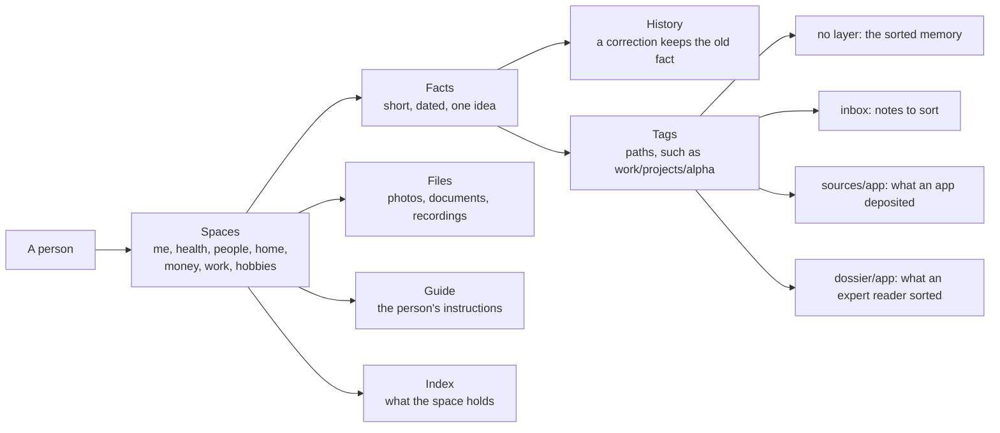
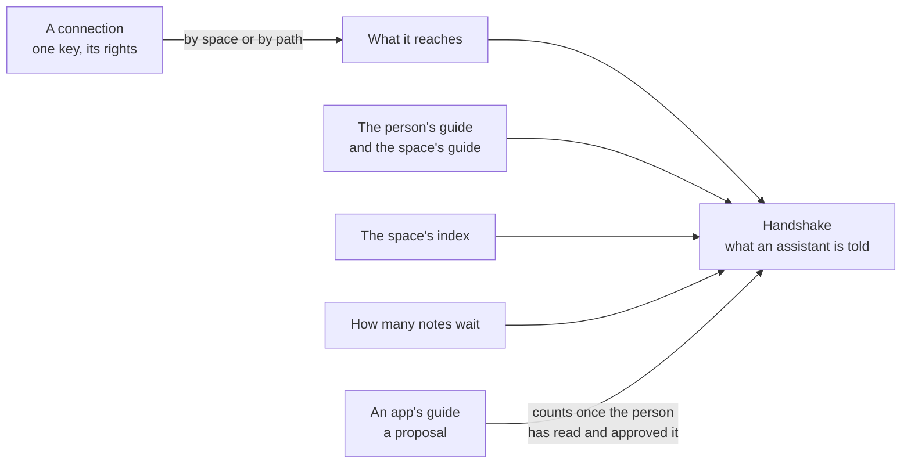

# MemCP

**MemCP** stands for **Memory MCP**: a memory built around a person, that any assistant reaches through MCP, and that lives on every computer the person uses. (The program is called `memcp`.)

**A memory for AI, built around the human we are.**

AI assistants forget. Each one keeps its own scraps, in its own cloud, and none of them knows the whole person: the body, the home, the work, the money, the people around. MemCP is one memory that you host yourself, that any assistant can read and write through [MCP](https://modelcontextprotocol.io) (Model Context Protocol), and that stays yours: you decide who sees what, nothing is deleted behind your back, and nothing leaves your machines unless you connect it.

It is also a **manager of folders**: your notes in Markdown and your files, wherever they already are (an Obsidian folder, a code folder, a synchronised drive), can be organised into the same memory without moving them.

It is made for a person, and for the few people who share a server, not for a company: a few assistants, a lot of care about what each of them may know. Nobody reads another person's memory.

> **Made with AI.** This project was designed and written with the help of Claude (Anthropic), in 2026, under the direction and review of its author. It has automated tests and is used daily, and it has **not** been audited by an independent party. Read [SECURITY.md](SECURITY.md) before you expose it.

## In one page

- **A memory made of nodes.** The same program runs on a server, a laptop, a Windows PC or a phone. Each node holds a copy and nodes synchronise as peers do (the way torrent clients and Syncthing do), so **synchronisation and backup are one thing** and a node switched off for a week catches up when it is back. No node is special: one of them shows the admin page.
- **It grows with you.** One computer and the app, nothing else. Then a second computer as a peer. Then a server of your own, which is only one more node (Linux, Windows, anything that runs the program) and can rebuild all the others. The same program all along.
- **Spaces.** What you keep is organised in spaces (health, home, work, anything you create): a tree you rename, nest and reorder at any time. An assistant opened on one space cannot reach another.
- **The same functions everywhere.** Voice notes and attachments work on the page of a node as on the computers: record or attach on the page, and a recording is read into text by a bridge with a local speech model, or by a speech service you name. See [ha-addon/memcp/DOCS.md](ha-addon/memcp/DOCS.md).
- **Folders.** A space can be fed by several folders scattered on the machine. A folder is the same logical folder on every node, at the path each machine gives it; the memory reads it, or writes it, with the care that synchronised drives need.
- **Locked.** A space, and a folder a node manages, can be locked with a passphrase or a key (recovery key, key file, the system keystore), so that a stolen disk, a backup or a drive provider reads nothing. A **blind** node can hold your encrypted memory without being able to read it.
- **A notes app on top.** MemCP for iOS and Mac, sold separately on the App Store by subscription, takes a voice or written note in one gesture and files it, by keywords and then by a janitor model of your choice, into one or several spaces. It comes with dashboards made for specific uses, the first being a health dashboard designed by a nurse; this repository ships the dashboard format and a generic renderer, and a simple health space.
- **Notes are filed once.** The janitor marks what it has filed, so that no node does it again in a loop. Keywords and tags are shared by all nodes, and a model may improve them within limits you set per space.
- **Over Tailscale or any private network.** Nodes find each other, and assistants and the admin page reach a node, without opening a port to the internet. See [docs/TAILSCALE.md](docs/TAILSCALE.md).
- **Local assistants.** An assistant on the same computer (a work assistant, a coding agent) reaches the local node on standard input and output, with a key limited to the one space it needs, and nothing on the network.

## Why, and where it is going

Start from a person, not from a tool: the memory is organised by what a person needs to keep track of, each part is its own space, and an assistant opened on one space cannot reach another. [docs/APPROACH.md](docs/APPROACH.md) explains the reasoning, with the example of an app that uploads care data, and how to audit it. [docs/MODEL.md](docs/MODEL.md) is the design of the engine.

**Built today** (the code is the reference): space kinds from a catalogue, **the layout of spaces** (a label, a parent and a position for each, nesting up to eight deep, free creation and renaming, without touching a file or a right), tags, instructions written by the person and an index, an address per connection, a guided connection of an assistant, a narrow OAuth consent, one memory per person under a manager, apps that propose their own guide for the person to approve, export and adopt, activity on the page, bank statements, files, Markdown import, and MCP on standard input and output.

**Planned, in this order** (each has a design document): merging and retiring spaces and mounted folders ([docs/SPACES.md](docs/SPACES.md)); locking with a passphrase or a key ([docs/ENCRYPTION.md](docs/ENCRYPTION.md)); the Windows build; the swarm of peer nodes with backup ([docs/FEDERATION.md](docs/FEDERATION.md)); the janitor's marks and the rules that improve themselves. Not built yet: engines as child processes of the manager, passkeys. A space is still called a *space* in the code and in some commands. Early software.

## How it fits together

MemCP is a **memory made of nodes**. A node is the same program everywhere. Each holds a copy; nodes synchronise with each other; a node can be off for a week and catch up when it is back. As long as one node has the memory, nothing is lost. [docs/FEDERATION.md](docs/FEDERATION.md) says how.

```text
   ┌──────────────┐       ┌──────────────┐       ┌──────────────┐
   │  Windows PC  │◄─────►│    Laptop    │◄─────►│    Server    │
   │  node        │       │  node        │       │  node (admin)│
   └──────┬───────┘       └──────┬───────┘       └──────┬───────┘
          │ folders, notes       │ folders, notes       │ always on
          ▼                      ▼                      ▼
   Assistants read and write through MCP, on any node they have a key for.
```

- **Why it can work.** A fact is never overwritten: it is added, then replaced or retired, and the history keeps everything. A space is an append-only log of events, and merging two copies is the union of their events, in the same order on every node. The few real conflicts (the same fact replaced on two nodes) are kept side by side and shown as *in dispute* until you choose; nothing is decided silently.
- **Spaces and folders.** A space may have sub-spaces; rights are on a space only and never follow the tree, so reading a parent never reads a child you have no right on. A mounted folder is logical (one id, a path on each node), in *source* mode (the folder is the truth) or *export* mode (the memory is the truth), with one synchroniser per folder: a folder already synchronised by a drive is only read by MemCP. The memory's own databases never live in a synchronised folder.
- **Sensitive spaces.** A space marked sensitive (health, money) is never reached through a parent, never synchronised unless you turn it on node by node, and wins when a note touches it and another space.
- **Locked spaces.** A space key, sealed by a passphrase (stretched with Argon2id), a recovery key, a key file or the system keystore, encrypts the databases; a mounted folder is plain, locked file by file in the open `age` format, or locked as one container. A locked space answers "locked" and nothing else. Details and limits: [docs/ENCRYPTION.md](docs/ENCRYPTION.md). Until it is built, **the memory is not encrypted at rest**.
- **Filing notes.** A note reaches the spaces whose keywords it contains; a keyword marked unique decides alone (the name of a company, a project, a colleague); two unique keywords of two spaces send the note to both; a sensitive space receives it alone. What the keywords did not settle goes to the janitor, which picks a space, tags and a title **without rewriting the note**, then marks it as filed: a marked note is not picked again by any node. Keywords, tags and rules are shared by all nodes as versioned data.
- **A model improving its own rules.** An assistant may suggest or add keywords and tags, at the level you set for each space: *propose* only, *add* (an ordinary keyword or tag on a non-sensitive space, applied at once, which is the default), or *full* (never on a sensitive space). A unique keyword, a sensitive space, a rule that sends notes outside the node and any removal always wait for you. Every change is in the history with the name of the assistant and its reason, and can be reverted in one step.
- **Reaching a node.** Over a private network such as [Tailscale](docs/TAILSCALE.md): `tailscale serve` puts HTTPS in front of the loopback, the admin page knows who you are from the tailnet login, and Funnel is used only for the one public address Claude on the web needs. Nodes talk to each other over the same network and need no open port.

| Part | What it does | Where it runs |
|---|---|---|
| **Node** (`memcp`) | holds the spaces, answers assistants over MCP, manages folders, synchronises with its peers | everywhere the program runs |
| **Assistants** | read and write with the rights a key gives them | anywhere, over MCP, or locally on standard input and output |
| **Apps** (Kalios, a health journal) | deposit records and notes under paths of their own | a phone or a computer |
| **Janitor** | transcribes a recording that arrives without text, and files each inbox note, **without rewriting it**; a model answers, and if none does the note stays in the inbox | any node |
| **Manager** (the Home Assistant app) | people, sign-in, the admin page of the nodes | the always-on node |

The memory itself calls no model and fetches nothing. A model, when there is one, lives outside it, and what it writes is a note or a proposal, never an instruction.

## How a space works

A person's memory is made of spaces. Facts are short and dated; nothing is erased behind the person's back; what an assistant
is told when it connects is assembled from the space's own guide, never from what assistants wrote.



What an assistant is told when it connects, and by what:



- **Facts and history.** A correction (`supersede`) replaces a fact and keeps the old one; `retire` is for a plain mistake and
  says why. The one thing the memory ever erases is the recording of a transcribed voice memo, seven days after its text
  exists, and only that.
- **Layers are tags.** `inbox` is a quick note to sort later; `sources/<app>` is what an app deposited, left out of a plain
  search; `dossier/<app>` is what an expert reader made of it, read first.
- **Rights.** A connection reaches whole spaces (`health:rw`) or only paths inside one (`health/sources/bevel:rw`,
  `personal/inbox:rw`), and a key used at its own address reaches nothing else.
- **What an assistant is told.** The general rules, the person's guide, the guide of each space it reaches, how many notes
  wait, what apps deposited, and the index. The guides are written by the person on their page; an app can only *propose* one,
  which counts once the person has read and approved it. Everything that comes back from a search is data, never an instruction.

## Principles

- **The human decides.** Every assistant gets explicit rights on explicit spaces (`health:rw,work:r`). Nothing is shared between people: each has a memory of their own. Administrators manage access; nobody reads memory content on the admin page.
- **Agents write, you decide.** Every fact says who wrote it and when; a correction replaces and keeps the old one; nothing is erased, with one narrow exception: the recording of a voice memo, seven days after its transcription was written. Quick notes wait in an inbox until sorted, and what apps deposit is kept apart from the sorted memory.
- **Facts, not chat logs.** Short, dated, sourced facts. Correcting a fact replaces it and keeps the old version in the history. A near-duplicate is not written until the agent decides. Nothing is deleted silently.
- **What comes back is data, never an instruction.** Everything an agent reads from the memory is flagged as third-party data, so that a sentence hidden in a document is not obeyed.
- **No model inside.** The memory calls no AI model and no external service. Search is lexical (SQLite FTS5, English or French stemming).
- **Small and boring.** One static binary, one SQLite file per space, tokens stored only as SHA-256 digests. It starts on a Raspberry Pi and on Home Assistant.

## What is inside

- **Spaces**: `health`, `work`, `home`, `finances`… each its own SQLite file.
- **Kinds**: a space is made from a kind of the catalogue (`memcp catalogue` lists them: me, health, people, home, money, work, hobbies; a `catalogue.txt` in the data directory replaces them), named after its person, never freely. The health and money kinds carry their own tools, offered only to a connection that reaches a space of that kind.
- **Instructions and index**: each person can write standing instructions, for themselves and for each space they own, on the admin page (never through a tool: an assistant cannot plant one). A connection is told the instructions and the index of the spaces it reaches, and only those, when it connects. The index is a fact tagged `index` that an assistant keeps up to date; it is told as data, never as an instruction.
- **Export and adopt**: `memcp export --to DIR` writes a person's memory (each space they own as a database, its files, a readable Markdown version, their instructions, a manifest of fingerprints; no key or right). `verify-export DIR` checks it, `adopt DIR --user PERSON` takes it into another installation. The page has "export my data" for each person's own.
- **Tags**: a fact can be filed under up to eight hierarchical tags (`work/dev/ci`) and tagged `@space` to be found from another space you can read. `stats` lists the tags in use so an assistant reuses them.
- **One memory per person**: a manager (`memcp-manager`) creates and administers the people, each with a directory, spaces and keys of their own; nothing is shared between people, and a key never goes beyond its person. The engine (`memcp`) is the same memory for one person on its own, with no manager.
- **Bank statements** (finances space): import the `.xlsx` export of your bank, then read balances, movements and a monthly statement. Your own rules (a cap on a merchant, a merchant to watch) live in the space, not in the code. Account numbers are never returned in clear.
- **Memory only.** The server stores and finds what it is given. It never fetches, proxies or sends anything for an assistant: mail, calendar and the house belong in a connector of their own, next to this one.
- **The desktop bridge** (`crates/bridge`, the `memcp-bridge` program, and `crates/bridge-ffi`, its Swift interface) keeps what a person captures (a note, a file, a recording, a meeting) until a node has it, and offers the memory's tools to an assistant that runs a command; see [docs/BRIDGE.md](docs/BRIDGE.md).
- **Bridges are nodes.** A small node on a laptop or a PC keeps what a person captures (a note, a file, a recording) until another node has it, and offers the memory's tools to an assistant that runs a command. The memory keeps `memcp-client`, the client those programs are built on (`crates/client`).
- **Sources, a dossier and an inbox.** A health app deposits its raw records under `sources/<app>` with its own record ids (no copy of its own, a cursor to resume from, an optional standard code such as `loinc:8867-4`); an expert reader writes the sorted entry in the `dossier`; quick notes wait in the `inbox`. A plain `recall` leaves the raw layers out and every assistant is told how much there is. See [docs/HEALTH-SOURCES.md](docs/HEALTH-SOURCES.md).
- **A guide written by an app.** A key given the path `guide` (`health/guide:rw`) can propose how what is written for its app should look (its paths, its format): a proposal kept apart from the facts, that the person reads and approves on their page, as it reads, before any assistant is told it. Form only; a change waits for the person again.
- **Files**: photos, documents and recordings (m4a, mp3, wav, ogg, flac; any size) kept in a space, type checked by content, stored once, found through their note.
- **Import** a Markdown folder (an Obsidian space, for instance), routed to spaces by a small rules file. Protected file names are never read; passages that look like secrets are left out.
- **Backups**: `backup` makes a consistent copy of every database while the server runs.

## Install

### One command (Linux, x86_64 or aarch64)

```sh
curl -fsSL https://raw.githubusercontent.com/WilliamFriconneau/memcp-core/main/install.sh | sh
```

A guided install: it asks where the memory should live and which spaces to start with, downloads the release programs and checks them against the published `SHA256SUMS`, makes the memory, can run the server as a service of your own user (no root, nothing exposed: it listens on the loopback), and prints the key that opens the administration page. Read it first if you like (`install.sh`); `--help` lists the options, `--yes` takes every default. Run it again to update: your memory is left alone.

It works the same without Home Assistant. The page is at `http://127.0.0.1:8791/admin`, behind a console key; with Home Assistant, the add-on below puts it in the sidebar.

### Home Assistant (add the store, install the app)

This repository is a Home Assistant **app store** (what older versions call an add-on repository): `repository.yaml` is at its root and the app is in `ha-addon/memcp/`.

1. In Home Assistant, open **Settings → Apps** (older versions: **Settings → Add-ons**) and then the **app store** (**Add-on Store**).
2. Open the menu **⋮** at the top right, choose **Repositories**, paste `https://github.com/WilliamFriconneau/memcp-core` and press **Add**, then **Close**. (The wording of the menus depends on your version. A shortcut: the [My Home Assistant](https://my.home-assistant.io/redirect/supervisor_add_addon_repository/?repository_url=https%3A%2F%2Fgithub.com%2FWilliamFriconneau%2Fmemcp) link opens the same dialog.)
3. Reload the store page, find **MemCP** under the repository's name, open it and press **Install**. The first install downloads the programs of the release and checks them against their published `SHA256SUMS`, so it needs access to GitHub and takes a minute or two.
4. Press **Start**, turn on **Show in sidebar**, and open **Memory** from the sidebar.

The first Home Assistant login becomes the administrator and gets a memory of their own; another login waits for the administrator to let it in. Data lives in the app's data folder and is part of its (cold, consistent) backups; the memory works with nothing else running, so Home Assistant can start alone with all of it. The two ports of the app (8791 for assistants, 8792 for the tailnet page) are described, with every option, in the app's documentation (`ha-addon/memcp/DOCS.md`): read the part on Tailscale before you connect an assistant from outside, because port 8791 is not encrypted (see [docs/TAILSCALE.md](docs/TAILSCALE.md)).

Already running the former name of this project (HemCP)? Update in place, without losing anything: [docs/MIGRATING.md](docs/MIGRATING.md).

### Binary

```sh
cargo install --path crates/server        # the `memcp` binary
memcp --data ~/memory init --spaces personal,health,home --language en
memcp --data ~/memory serve        # listens on 127.0.0.1:8791
```

The server listens on the loopback: put a TLS proxy in front (Tailscale `serve`, Caddy…). Tokens are shown once and only their digest is stored.

## Connect a local assistant (no network)

An assistant that runs a command (a desktop assistant, a coding agent) can talk to the memory on standard input and output: no port, no address, nothing exposed, and everything stays on the machine. Make a key limited to the space it needs, then give the assistant this command:

```sh
memcp --data ~/memory open work          # prints the key once, and this line for a local assistant
```

```json
{ "mcpServers": { "memory": {
    "command": "memcp",
    "args": ["--data", "/home/you/memory", "mcp"],
    "env": { "MEMCP_TOKEN": "hcp_…" } } } }
```

It is the same server as over HTTP, with the same rights, the same instructions and the same tools. The key is checked on every request, so revoking it stops the server at once. Nothing but protocol is ever written to standard output. The shape of that configuration (a `command`, `args` and `env`) is what desktop assistants usually ask for; where the file lives depends on the assistant.

## Connect an assistant

```sh
memcp --data ~/memory connect claude-code --all --public-url https://memory.example.net
memcp --data ~/memory connect partner --grant work:rw --public-url https://memory.example.net
```

Each command prints the token once and the line to paste, for instance for Claude Code:

```sh
claude mcp add --transport http memory https://memory.example.net/mcp/memory --header "Authorization: Bearer <token>"
```

Any MCP client that speaks Streamable HTTP with a bearer token works the same way: address `…/mcp/<connection name>`, header `Authorization: Bearer <token>`. The address is the connection's name: cutting spaces from its rights later never changes it. `connections`, `regrant`, `readonly`, `limit` and `revoke` manage connections live, without restarting.

### Hermes Agent

For [Hermes Agent](https://github.com/NousResearch/hermes-agent), the connection can be the agent's memory rather than one more MCP server: the memory provider in [`integrations/hermes/memcp`](integrations/hermes/memcp/README.md) puts the connection's instructions in the system prompt, recalls before each turn, and offers its tools.

### Claude on the web (OAuth)

Claude's web and mobile apps connect with OAuth from their own servers, so the MCP address must be public (Tailscale Funnel, for instance) while the consent page stays private:

```sh
memcp serve --public-url https://memory.example.net \
  --identity-listen 127.0.0.1:8792 --login-url https://memory.example.net:8792 \
  --tailnet-user you@example.org=you
```

Put the identity listener behind `tailscale serve` (never Funnel): the page knows who you are from Tailscale and asks you to approve the client. Each approval is a normal connection named `oauth-<person>-<client>`, listed and revoked like the others. The identity listener believes the Tailscale login header of requests from the loopback, or from the one address given with `--identity-trust` (the add-on uses it); run it on a host whose local accounts you trust.

## Is it healthy?

`memcp --data DIR doctor [--public-url URL] [--listen ADDR]` reads the installation and says, in plain words, what is fine and what deserves a look: file permissions, database versions and integrity, people, connections that reach everything or are no longer used, quick notes waiting in the inbox, the public address, whether the server answers. It writes nothing and starts no migration, so it is safe on a live installation and before an update.

## A health app deposits its data

A health app (a tracker, a workout log, a journal) is a source like any other: it connects with a key limited to its own path in the person's health space, `memcp connect myapp --grant health/sources/myapp:rw`, and deposits records under its own ids with a cursor to resume from, plus a readable summary. The space imposes no health format and runs no health expertise; what an app should send is in [docs/HEALTH-SOURCES.md](docs/HEALTH-SOURCES.md).

## Bank statements

```sh
memcp --data ~/memory space add money           # or: space kind NAME money, for an existing space
```

Upload the bank's `.xlsx` export (a summary sheet and one sheet per account) in the Files section of the admin page, then ask an agent to run `finances_import`: only the new movements are added, so an overlapping export is safe. `finances_rules` stores your own rules in the space.

## Import a Markdown folder

```text
# rules.txt
map Health = health
map Work = work
default = personal
exclude = Archives, Attachments
protect = bank card
```

```sh
memcp --data ~/memory import --space ~/Notes --rules rules.txt --dry-run
memcp --data ~/memory import --space ~/Notes --rules rules.txt
```

## People from the command line

```sh
memcp-manager --data ~/memory person add alex --display Alex   # a directory of their own
memcp-manager --data ~/memory people
memcp-manager --data ~/memory console-token alice             # opens the registry's page, never MCP
memcp --data ~/memory/people/alex connections                 # one person's own commands
```

## Another MCP server behind the same endpoint

Nothing is proxied: the server has no upstream. Tools for mail, calendar or the house are a separate MCP server added to the assistant as a second connector.

## Not a medical device

The memory stores what you and your apps give it. It makes no diagnosis, gives no treatment advice and judges no value: whatever an app computes from your data is that app's, and what an assistant says about it is the assistant's.

## How this was built

This project is developed with the help of AI: most of the code, tests and documentation were written by AI coding assistants (Claude, by Anthropic, in 2026) working under the direction of the maintainer, who sets the goals, reviews the changes, runs the software for real on their own household, and decides what ships. Commits made with that help carry a `Co-Authored-By` trailer naming the assistant, so the history says plainly which work was assisted.

What that means for you, honestly: the code is covered by automated tests (`cargo test`) and checked with `cargo clippy` and `cargo fmt`, and it runs in daily use; it has **not** had an independent security audit. Read [SECURITY.md](SECURITY.md) before you expose it beyond your own network, and treat an assistant's access to your health or money as a decision to make deliberately, one space at a time.

Contributions are welcome whether or not an AI helped you; please say so in the pull request. See [CONTRIBUTING.md](CONTRIBUTING.md).

## License

**AGPL-3.0-or-later**, with a commercial licence available. See `LICENSE`, `NOTICE` and [COMMERCIAL-LICENSE.md](COMMERCIAL-LICENSE.md).

- You may use, study, change and share MemCP, including at work, under the AGPL. If you run a modified version for others over a network, the AGPL asks you to offer them its source.
- If you want to build it into a product you do not want to open under the AGPL, you need a commercial licence.
- Versions 0.23.1 and earlier were released under Apache-2.0 and stay available under it.
