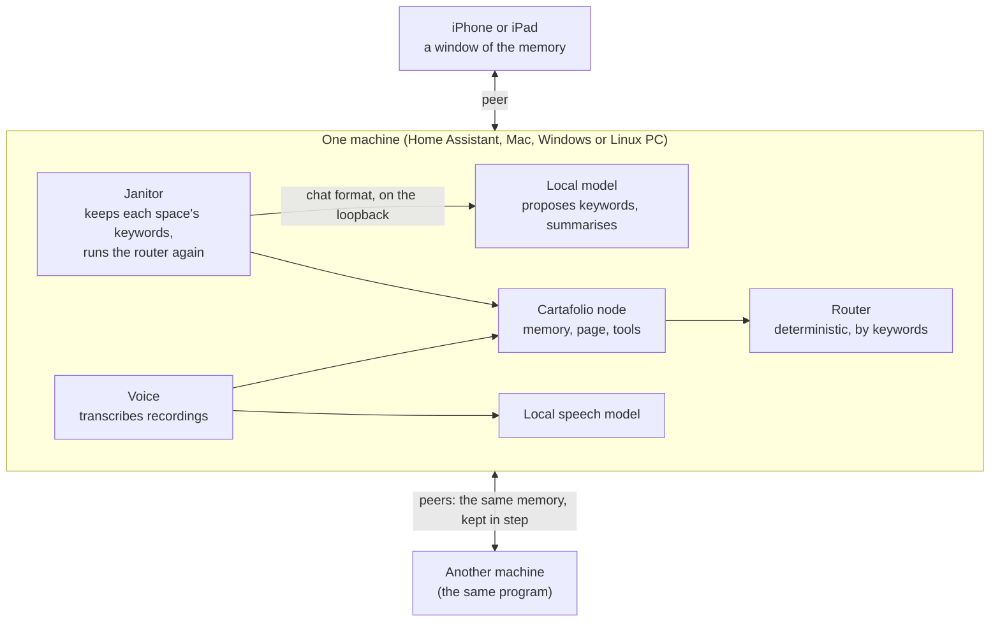

# Local tools: how each machine sorts, transcribes and summarises

Every node is the same program and does its own work with the tools of its machine: nothing needs a cloud service, and a
remote model is only ever a choice of the installation. See the principles in the [README](../README.md#principles).

## Which local model on which machine

| Machine | Model for the janitor | Speech | How the janitor reaches it |
|---|---|---|---|
| Mac (Apple silicon, macOS 26) | Apple Intelligence (Foundation Models) | Whisper, in the app | the Mac app serves it on `127.0.0.1` in the OpenAI chat format (`models = api`) |
| Windows PC | Foundry Local (any Windows PC; GPU or NPU when present, CPU otherwise), or Phi Silica on a Copilot+ PC | Whisper (Foundry Local carries it) | Foundry Local: its local OpenAI-compatible server, directly (`models = api`, `api_url` its address). Phi Silica: through the Windows app, as on the Mac |
| Linux PC, Home Assistant | Ollama (`models = local`) or Foundry Local on Linux | a speech model on the machine | `ollama_url`, or `api_url` |
| iPhone, iPad | Apple Intelligence | Apple's recognition, on the device | in the app: it sorts what it captures before sending it |

**Can a Windows PC use "Copilot" locally?** The Copilot assistant of Windows and Microsoft 365 answers from Microsoft's
cloud: it is not a local model and is never the janitor's default. What runs on the PC itself is:

- **Foundry Local** (Microsoft): an on-device runtime with an OpenAI-compatible API and an optional local web server; chat
  models (Phi, Qwen, Mistral…) and Whisper; Windows, macOS on Apple silicon and Linux; no Azure subscription; inference stays
  on the device, the network is used to download models. Source: *What is Foundry Local?*, Microsoft Learn,
  https://learn.microsoft.com/en-us/azure/ai-foundry/foundry-local/what-is-foundry-local (page dated 22 October 2026, read
  16 November 2026; official documentation). The port of its local server is set when it starts: give that address to
  `api_url`.
- **Phi Silica** (Microsoft): the small model of Copilot+ PCs, run on their NPU, reached by an app through the Windows AI
  APIs (`LanguageModel`), not by an address. Source: *Phi Silica*, Microsoft Learn,
  https://learn.microsoft.com/windows/ai/apis/phi-silica (read 16 November 2026, not dated). A Windows app of Cartafolio would
  serve it to the janitor on the loopback, the way the Mac app serves Apple Intelligence.

What has been checked: the Mac's way (Apple Intelligence served on the loopback, a note classified without leaving the Mac).
Not yet checked on a real machine: Foundry Local and Phi Silica with the janitor.
